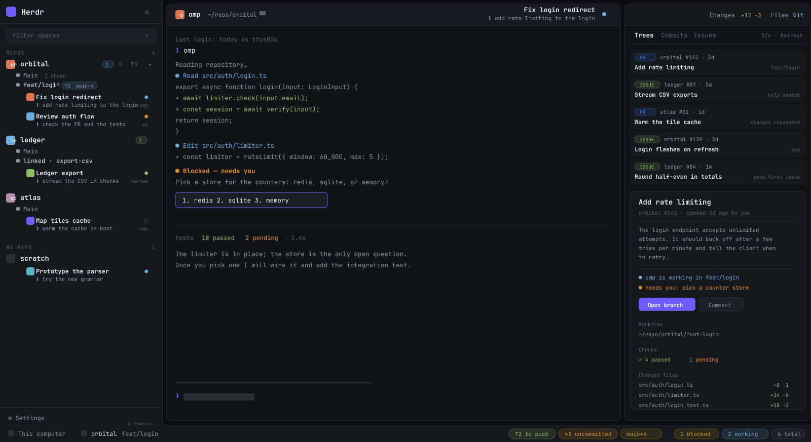

# Repos & Agents — a Herdr layout

**Your repos, their branches and worktrees, and the agents working in them — as one tree you can read at a glance, with one git panel beside it and a wall that shows every running agent at once.**

**Site:** https://meviusisback.github.io/herdr-gh-board/

---

A Herdr window built around the repos you keep in one folder: a sidebar that is a tree of every
repo → its main checkout, branches and worktrees → the agents running in each, how far each one
is from origin and from main, and in what state its agents are; one git panel on the right
(every worktree, the commit graph, the open issues and PRs); a pane header that names what each
agent is actually working on; and a wall that shows the running agents side by side without
moving anything.

## Install

Layout `repos-and-agents` and 17 mods. Ask your agent to read this repo (see
[RECIPE.md](RECIPE.md)) — the shortest path — or copy `layouts/repos-and-agents.json` and `mods/`
into `~/.config/herdr-app/` yourself and merge `keys.json` (Herdr asks before replacing a key you
already use). Then `Ctrl+Shift+L` picks the layout. Herdr's own mods stay Herdr's: this uses the
ones every install already has.

## Requirements

- Herdr app 0.1.16 or newer; everything it needs of herdr-core comes with it (`hc`).
- `git` for every read in the tree and the panels; `gh` (authenticated) for issues, pull
  requests and making a repo; `sqlite3` to read omp's, opencode's and hermes' own stores for an
  agent's prompts, recap and title (without it those columns are simply empty).
- Thread titles use OMP's configured text model: `OPENCODE_GO_API_KEY` calls the provider
  directly, otherwise `omp` answers in print mode. Without either, rows fall back to the title
  the terminal already carries.
- `bun` only to run the unit tests (`bun test mods/spaces-tree/title-text.test.js`, …); the mods
  themselves have no build step and no dependency.
- Linux, macOS or Windows. On macOS Herdr's traffic lights sit at 12,16.

## What it talks to

- `git`, `gh`, `hc`, `sqlite3`, `powershell.exe` (Windows paths) and `herdr-app` (opening a live
  test's page) on your own machine, plus the agent CLIs you start.
- The GitHub API through `gh`, for issues and PRs of the repos you keep in the folder.
- **Thread titles** send up to eight of the agent's prompts, its folder, its previous title and
  (for OMP) its latest recap to OMP's configured text model: `https://opencode.ai/zen/go/v1`
  when `OPENCODE_GO_API_KEY` is set, else the provider `omp -p` uses. No terminal output, no
  diff, no file contents. A failed call keeps the previous title.
- Nothing else, unless you set `HERDR_AI_BASE` and `HERDR_AI_KEY`: then Commit/Merge drafting can
  post the diff you picked to that OpenAI-compatible endpoint. It is off until you set both.

## What you see

- **Sidebar** (320 px, 44–480, theme `chrome`): Herdr's brand row on top, then the spaces tree,
  then Herdr's footer (Settings, Add machine). The tree is two lists. **Repos** holds every repo
  under the folder Settings names (`~/repo` unless changed): one row per repo — a colored square
  with its initials, its name, how many agents sit under it and in what state, git buttons, and
  `+` / bot / GitHub marks. Under it: `Main` (its own checkout), then a row per branch or
  worktree, then a row per agent. **No repo** holds the spaces whose folder is no checkout, one
  row each with their agents under it. A filter box and a sort/only control sit above both lists.
  The active space stays in view as the tree changes.
- **Agent rows** are led by the work, not the program: the generated thread title (or the
  terminal's own title), then the last thing the person asked, then the model and effort. The
  program's logo already says which agent it is. A thread with no title yet leads with the prompt
  instead.
- **The agent pane**: the shown tab's panes, 8 px apart on the `canvas` background, each framed
  as a card with a 10 px radius and a 1 px `border` (`accent` while focused), under a 42 px
  header drawn by `pane-prompt`: the program's icon, the agent's name or the terminal's title,
  its folder, the live-test button, then on the right the thread title over the last prompt,
  the state (spinner, `Needs you`, or a done dot), and — on hover — split / zoom / close. The
  tab strip is gone and the wall chip lives in the wall's own status row: the tree is how work is
  picked. Herdr's own tab keys still switch tabs (`Ctrl+Tab`, `Ctrl+1…9`) and start one
  (`Ctrl+Shift+T`).
- **Tools row** (42 px, above the right column, right-aligned): `Changes` with git's own
  additions/deletions against `origin/main` (or `main`, `master`), `Files`, and `Git` — each
  filled when that panel is shown. Closing the column leaves a small reopen button in the agent
  header.
- **Git panel** (368 px, 280–900): one panel with three views — `Trees` (every checkout of every
  repo, the shown space's highlighted), `Commits` (the commit graph of the shown repo, with
  files and stats) and `Issues` (open issues and PRs of the picked repos, with their
  conversations). It refreshes every 15 s, and each space remembers which panel it had open.
- **Status bar** (34 px): bottom left the machine and the repo the agents on screen share —
  click it for that checkout's worktree picker. Bottom right: how far that space is from origin
  and from main, then every agent state with its count, as chips. Working and blocked chips open
  the active wall; idle, done and the total chip open every agent's wall.
- **The wall**: `Ctrl+Shift+G` (or a status chip) turns the window into a grid of the running
  agents' live terminals, across spaces, each tile headed by its state, space, thread title and
  branch. The wall's own status row carries the chip back to the tabs.

## How it behaves

- An agent's state comes from the agent itself and colours every chip above it: working, blocked
  (needs you), done (finished while you weren't looking), idle. A repo row counts its agents'
  states; the status bar counts everyone; working and blocked chips pulse.
- **Titles follow the thread.** `spaces-tree` reads the agent's own store (omp, pi, opencode,
  hermes): the last eight prompts, plus OMP's or hermes' latest recap. When that set changes it
  writes a short title once, one request at a time, and stores it per terminal. The row, hover
  card, pane header and wall tile read the same title; the raw prompt stays in the tooltip. A
  title nobody refreshed in 30 days is dropped. A failed or absent generator falls back to the
  terminal's own title.
- A branch row's chips say how far it is from `origin` (ahead/behind, or local-only) and from
  `main`, and whether the checkout has uncommitted changes. Clicking a repo folds it; a branch row
  goes to that space; an agent row goes to that agent. Right-click a space, repo, branch or agent
  for its menu.
- On an uncommitted checkout, `✎` opens Commit (drafted message, paths picked one by one); on a
  branch ahead of main, `main+N` opens Merge. A repo with no `github.com` remote shows the GitHub
  mark: it creates the repo with `gh`, pushes, and gives the branch its upstream.
- A branch row's bot opens the `+` menu for that branch, as a comic bubble, so an agent starts in
  that branch's own space instead of the shown one.
- New space (`Ctrl+Shift+N`) asks for a name first and gives the space a folder of its own
  (`~/spaces/<name>`, or a new repo under the repos folder); New worktree opens one from a branch
  or from an issue/PR, including from the status bar's repo chip.
- A pane's header can start a live test of the folder's dev server and open its page.
- The wall keeps nothing running differently: each agent stays in its space, and picking a tab,
  agent or space leaves the wall for it. The set it shows is remembered. An active wall of one
  working or blocked agent is allowed; the all-agents wall still needs two.
- All of it follows the theme (`canvas`, `chrome`, `border`, `accent`, the status colors) and
  works on several machines: a space on another machine has its git read there.

## Keys

`Ctrl+Shift+G` wall · `Ctrl+Shift+N` new space · `Ctrl+Shift+Alt+S` Settings (repos folder) ·
`Ctrl+Shift+Alt+T/C/I` the Git panel's Trees, Commits, Issues. Herdr's own keys are untouched, so
tabs, panes and `Ctrl+Shift+T` keep working; `keys.json` is a merge, and the installer asks
before replacing a key you already use.

## License

MIT (see [LICENSE](LICENSE)). The mods cloned from Herdr's own are Apache-2.0 derivatives — see
[NOTICE](NOTICE).
