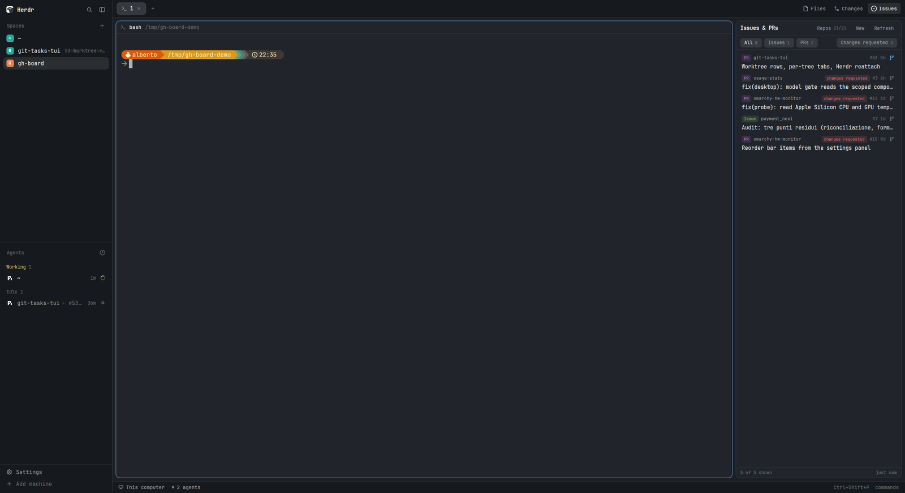
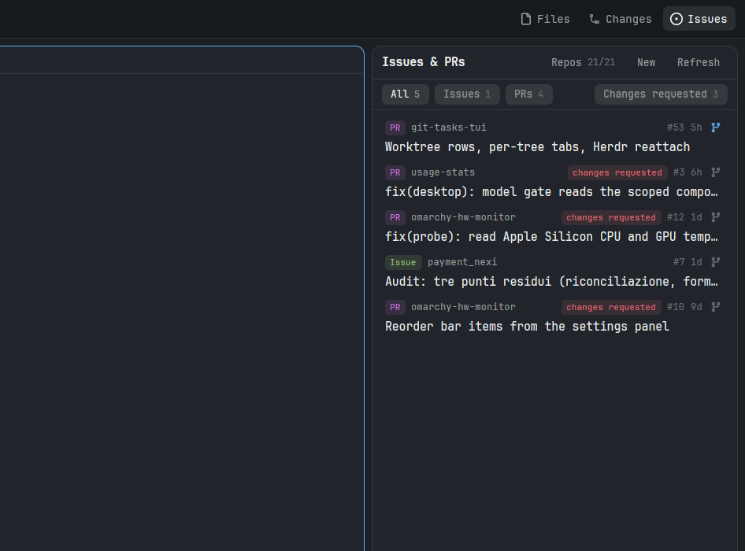
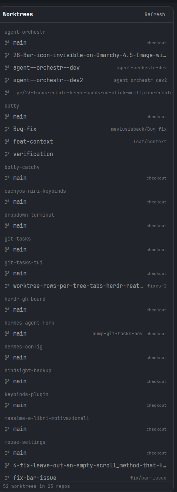
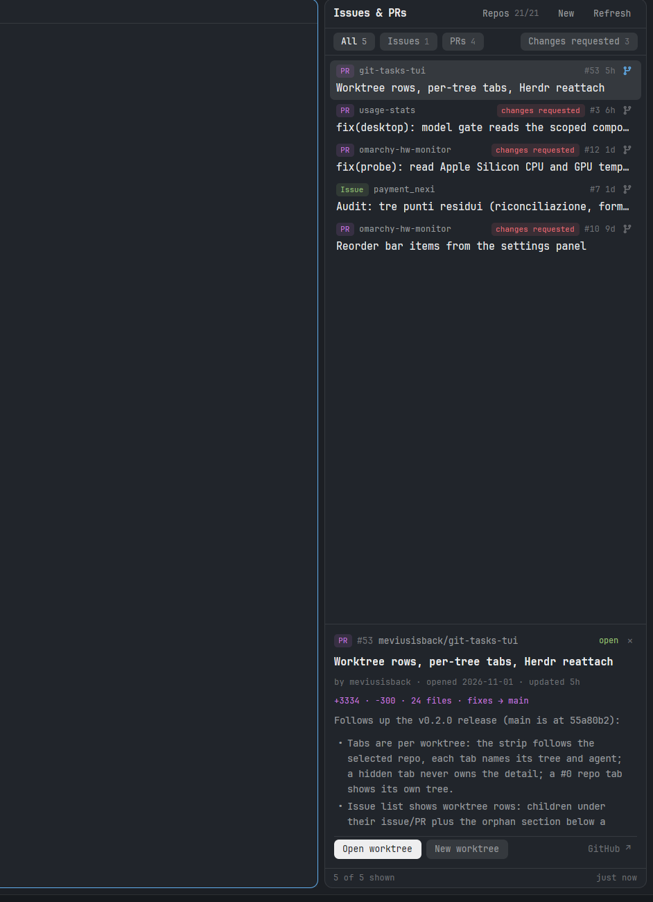
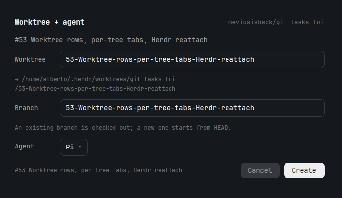
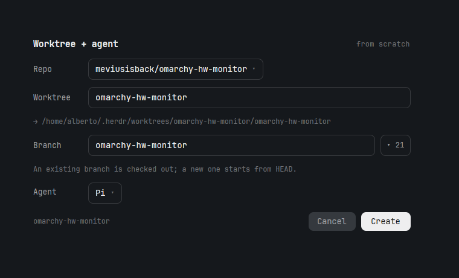
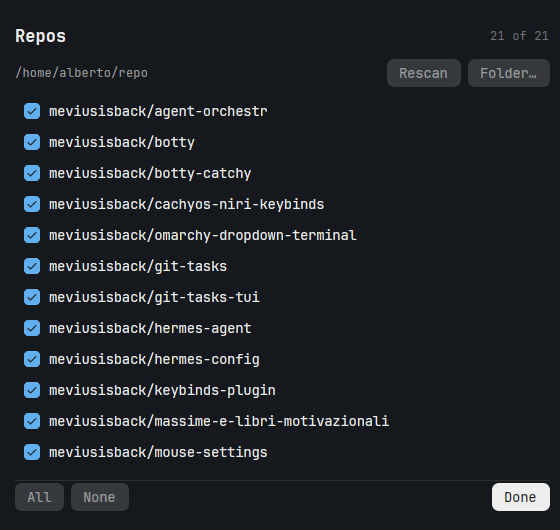

<div align="center">

# Issues & PRs — a Herdr panel

**Every open issue and pull request of the GitHub repos you keep in one folder, in a side panel — and one click from an issue to a worktree with an agent already sitting in it.**

[](https://herdr.dev)
[](#install)
[](#what-is-in-the-box)
[](#requirements)
[](#requirements)
[](#what-it-talks-to)
[](LICENSE)



</div>

---

## What you get

- **One list, every repo.** Scans a folder (`~/repo` by default), reads each checkout's `origin` remote, and asks `gh` for the open issues and PRs — one batched GraphQL query per 20 repos, plus a detail fetch for the newest few rows so their cards are ready before you hover.
- **A real panel, not a window.** It lives in the same right-hand column as Herdr's *Files* and *Changes*, opens from an **Issues** button in the tab bar, and stays open in every space — each space remembers which panel you had (or that you closed it), and a space you never touched opens on Issues.
- **Details on hover, pinned on click.** Hover a row for a card with the description rendered as markdown, state, author, dates, labels, review state and diff stats. Click it and the same card docks at the bottom of the column, where it stays while you scroll — and the window jumps to the agent working on that issue, when there is one.
- **Agents and issues follow each other.** Clicking an agent in the sidebar selects its issue/PR in the panel and docks its card (or clears the selection when the agent works on nothing); clicking an issue row selects it *and* switches to its agent's tab.
- **Filters that behave.** `All` / `Issues` / `PRs` are tabs; `Changes requested` is a separate filter you can switch on and take off with its ✕. They sit together when they fit, and it wraps to its own line when the panel is too narrow.
- **Repo picker.** Choose which repos are asked about, rescan the folder, or point the panel at a different folder entirely.
- **Worktrees at a glance.** A second **Trees** button shows every checkout under `~/repo` grouped by repo — main plus linked trees with their branches; a row jumps to the space showing that folder, or opens it.
- **Issue → worktree → agent in two clicks.** The branch button on a row opens a small dialog: the worktree and the branch are already named after the issue, the agent is the one you used last, and `Create` gives you `~/.herdr/worktrees/<repo>/<name>` as a space with that agent waiting for input. If the worktree is already there, the button just takes you to it.
- **Or start from nothing.** The panel's `New` button does the same without an issue: pick a repo (or any folder — it initializes it), a branch that exists or a new one, and the agent.
- **Your agents first.** The `+` menu pins your favourite agents to the top — edit the `PINNED` list in `mods/new-menu-pinned/main.js` to change them.

## The panel



Each row is one PR or issue: kind, repo, number, title, and — when the panel is wide enough — labels, review state and author. The branch icon on the right is the worktree shortcut; it turns accent-coloured when that worktree already exists. A click selects the row and jumps to its agent's tab when one exists; a second click closes the card.

## Trees



Every `git worktree list` under `~/repo`, grouped by repo: the main checkout (tagged `checkout`) plus each linked tree with its branch. The row of the space you are in is highlighted; clicking any other row switches to the space showing that folder, or opens it as a new space. Refreshes every 15 s.

## Details



The docked card keeps the header (`PR #53 repo state ✕`), the meta line, the tags, the diff stats and the full description — scrollable — with the two worktree buttons and a GitHub link at the bottom.

## Worktree + agent

The dialog is pre-filled from the issue or PR: `#12 fix(probe): read Apple Silicon CPU and GPU temperatures` becomes the worktree and the branch `12-fix-probe-read-Apple-Silicon-CPU-and-GPU-temp`. Both are editable, and the agent is a dropdown that remembers your last pick.

<table>
<tr>
<td width="50%"></td>
<td width="50%"></td>
</tr>
<tr>
<td>From an issue or PR: names taken from it.</td>
<td>From scratch: repo, branch (with its existing branches one click away) and agent.</td>
</tr>
</table>

`Create` runs `git worktree add` (a branch that already exists is checked out, a new one starts from `HEAD`), then `space.new` — so you get a space named after the repo, a tab named after the issue, and the agent running there with an empty prompt.

## Repos



Only the picked repos are queried. `Rescan` re-reads the folder, `Folder…` opens the system folder picker, and a selection that loses a repo (because you deleted the checkout) is pruned automatically.

## Trust

**This is code, not a skin.** A Herdr mod runs inside your session with your own privileges: it can start any program, read files in your home and use your `gh` credentials. This package is seven such mods (~2200 lines of plain JavaScript), so the honest install procedure is *read them first* — `mods/*/main.js`, no build step, no dependencies, no network code beyond the `gh` calls described above.

`herdr-app check` is **not** a safety gate: it loads a mod once and reports whether it is compatible with your Herdr version. It says nothing about what the code does.

What the mods are allowed to do in this package, and nothing else:

| | |
|---|---|
| Programs started | `gh`, `git` (both with an argv array, never a shell), and the agent you pick in the dialog, which Herdr starts for you |
| Files read | the folder you point the panel at (a non-recursive listing plus each checkout's `origin` remote) |
| Files written | under `~/.herdr/worktrees/`; git's own bookkeeping inside the source repo; and a folder that is *not* a repository yet is initialised (`git init` + one empty commit) if you explicitly create a worktree in it through `Other folder…` |
| State kept | Herdr shared state (`gh-board.*`) and the app's own `localStorage` (the filter choice, and the per-space panel toggle in `tabs-gh`) |
| Network | only through `gh`, with your credentials — the panel renders issue text, and **images and raw HTML are stripped from issue bodies** before rendering so a crafted issue cannot fetch anything from your machine. Links in a body are handed to Herdr, which only opens http(s), and this package only allows `github.com` |

Security issues: see [SECURITY.md](SECURITY.md).

## Install

Requires **Herdr 0.1.11 or newer**, and `gh` (logged in: `gh auth status`) and `git` on `PATH`.

Pin the release you read. `v1.0.0` is the audited one; bump the tag deliberately.

```sh
set -eu
APP=~/.config/herdr-app
SRC=/tmp/herdr-gh-board

# 1. read it (there is no build step: what you read is what runs)
git clone --branch v1.0.0 --depth 1 https://github.com/meviusisback/herdr-gh-board "$SRC"
git -C "$SRC" rev-parse HEAD        # note this commit: it is what you are installing

# 2. back up what is there now
cp -r "$APP/layouts" "$APP/layouts.bak.$(date +%s)" 2>/dev/null || true
for m in gh-board gh-new gh-repos tabs-gh gh-trees agents-follow new-menu-pinned; do [ -d "$APP/mods/$m" ] && cp -r "$APP/mods/$m" "$APP/mods/$m.bak.$(date +%s)"; done

# 3. install (this replaces the seven mods and layouts/main-gh.json — including local edits)
rsync -a --delete "$SRC/mods/gh-board/" "$APP/mods/gh-board/"
rsync -a --delete "$SRC/mods/gh-new/"   "$APP/mods/gh-new/"
rsync -a --delete "$SRC/mods/gh-repos/" "$APP/mods/gh-repos/"
rsync -a --delete "$SRC/mods/tabs-gh/"  "$APP/mods/tabs-gh/"
rsync -a --delete "$SRC/mods/gh-trees/" "$APP/mods/gh-trees/"
rsync -a --delete "$SRC/mods/agents-follow/" "$APP/mods/agents-follow/"
rsync -a --delete "$SRC/mods/new-menu-pinned/" "$APP/mods/new-menu-pinned/"
cp "$SRC/layouts/main-gh.json" "$APP/layouts/"

# 4. load each mod once, then switch
for m in gh-board gh-new gh-repos tabs-gh gh-trees agents-follow new-menu-pinned; do herdr-app check "$APP/mods/$m"; done
herdr-app do layout.switch --name main-gh
```

The mods carry a `version` in their `mod.json`, so `grep version ~/.config/herdr-app/mods/gh-*/mod.json ~/.config/herdr-app/mods/agents-follow/mod.json ~/.config/herdr-app/mods/new-menu-pinned/mod.json` tells you what is installed.

Then open the panel with the **Issues** button in the tab bar (or `herdr-app do layout.select --stack panel-body --child gh-board && herdr-app do layout.show --id panel`).

If any of those mod names is already taken in `~/.config/herdr-app/mods/`, rename the folders *and* every place the names appear — `grep -rn 'gh-board\|gh-new\|gh-repos\|tabs-gh\|gh-trees\|agents-follow\|new-menu-pinned' "$APP/mods" "$APP/layouts/main-gh.json"`; the list is: the `content.mod` names in `layouts/main-gh.json`, the `enabled` entries and the `panelButton`s in `mods/tabs-gh/main.js`, the `openOverlay({mod: …})` calls in `mods/gh-board/main.js` (the `New`, `Repos` and branch buttons) and in `mods/tabs-gh/main.js` (the `+` button), and the `mods/<name>/*.svg` asset paths in all mods.

## Requirements

| | |
|---|---|
| Herdr | 0.1.11+ (`herdr-app --version`) |
| `gh` | authenticated, with `repo` scope — the panel runs `gh api graphql` and `gh issue/pr view` |
| `git` | on `PATH`, for reading remotes and making worktrees |
| Folder | a folder of checkouts, `~/repo` by default (change it in the panel's `Repos` dialog) |

## What it talks to

`gh` (GitHub's API, with your own credentials) and `git`, both through Herdr's `exec` with an argv array. The `GitHub ↗` button and links inside a description go through Herdr's own URL opener, which only accepts http(s), and this package only passes `github.com` URLs to it. Creating a worktree writes under `~/.herdr/worktrees/` plus git's own bookkeeping inside the source repo (`<repo>/.git/worktrees/<name>/`); a folder you point `Other folder…` at that is not a repository yet is initialised there. State lives in Herdr's shared state (`gh-board.repos`, `.selected`, `.root`, `.rescan`, `.agent`) and in the app's `localStorage` (the filter choice, and `tabs-gh`'s per-space panel memory).

## What is in the box

| Path | What it is |
|---|---|
| `layouts/main-gh.json` | Herdr's `main` layout with `gh-board` and `gh-trees` blocks in the right column's stack, the tab bar pointed at `tabs-gh`, and the sidebar pointed at `agents-follow` |
| `mods/gh-board/` | the panel: scan, query, list, filters, hover card, docked card; follows agent clicks (`gh-board.follow`) |
| `mods/gh-new/` | the `Worktree + agent` dialog (both modes: from an item, from scratch) |
| `mods/gh-repos/` | the repo picker |
| `mods/tabs-gh/` | Herdr's `tabs` mod with two extra panel buttons (`Issues`, `Trees`) and a per-space panel memory that defaults to open |
| `mods/gh-trees/` | the worktree browser: every checkout under `~/repo`, grouped by repo; a row jumps to (or opens) its space |
| `mods/agents-follow/` | Herdr's `agents` mod: a row click also tells the Issues panel what the agent works on |
| `mods/new-menu-pinned/` | Herdr's `new-menu` mod with favourite agents pinned to the top (edit `PINNED` in `main.js`) |

The mods talk to each other through Herdr's shared state: `gh-board.repos` (the scan), `gh-board.selected` (the picked repos), `gh-board.root` (the folder), `gh-board.rescan` (a request to re-read it), `gh-board.agent` (the agent you picked last) and `gh-board.follow` (the agent row just clicked, for the board to select).

## Notes

- **Issue text is treated as untrusted.** The description is rendered as markdown, but markdown images and raw HTML are stripped first (they would be fetched), and a description is capped at 4 kB before rendering. Links open only on a click, only through Herdr, and only to `github.com`.
- **The panel is a clone.** Herdr's shipped layouts and mods are read-only, so this package ships a copy of `main` (as `main-gh`) and of `tabs` (as `tabs-gh`), made from Herdr 0.1.11. They work as they are, but they do not receive Herdr's future updates — re-clone with `herdr-app do layout.clone '{"name":"main","as":"main-gh-2"}'` and copy the `gh-board` block over if you want a fresh one. `ctrl-shift-l` switches back to your own layout at any time.
- The worktree name is what the panel looks for: rename it in the dialog and the panel will not recognise that checkout again (the space is still created and selected).
- The agent list comes from Herdr's own table plus your `programs.json`; anything with a `run` entry shows up in the dropdown.
- `RECIPE.md` describes how the whole thing is built, if you want to change it rather than patch it.

## License

MIT — see [LICENSE](LICENSE). Do what you want with it.

---

<div align="center"><sub>Made for <a href="https://herdr.dev">Herdr</a>. Bugs and ideas: open an issue — the panel will show it to me.</sub></div>
