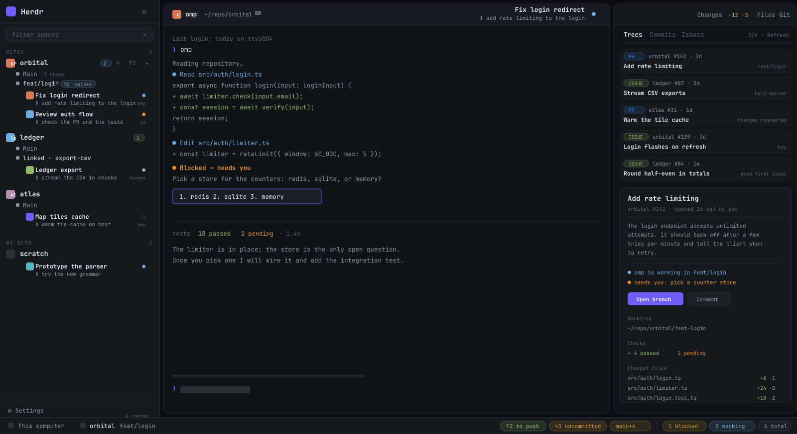

# Repos & Agents

A Herdr window built around the repos you keep in one folder. The sidebar is a tree — repo →
its main checkout, branches and worktrees → the agents in each — with each level's git distance
and each agent's state as chips; the right column is one git panel with three views (Trees,
Commits, Issues); the bottom bar says what the agents on screen share and how far it is from
origin; and a wall shows the running agents side by side without moving anything out of its
space.

## What you see

Left to right, on the theme's `canvas`, no title bar (macOS keeps the traffic lights at 12,16):

- **Sidebar** (320 px, 44–480, `chrome`, not resizable): Herdr's brand row on top (46 px, the
  shipped `workspace-chrome`), the spaces tree filling it, Herdr's footer at the foot (69 px,
  `workspace-chrome` with `{footer:true}`: Settings, Add machine).
  The tree is two labelled lists, each with its own count: **Repos** and **No repo**.
  - A **repo row** is a 22 px row: a 16 px rounded square in the repo's own color with its
    initials, the repo's name (or your name for it, bold when one of its agents needs you), then
    right-aligned micro-buttons: `✎` (uncommitted changes), `main+N` (ahead of main), GitHub
    mark (no `github.com` remote), bot (start an agent on a branch, as a bubble), `+` (new
    branch/worktree). Above the name of a repo with agents: a chip per state with the count.
  - A **branch row** (Main / a branch / a worktree, indented 16 px): the git mark, the name
    (`Main` for a repo's own checkout, a `linked` tag for a worktree), then chips: ahead/behind
    `origin`, distance from `main`, `local` when there is no upstream, and the agent count.
  - An **agent row** (indented 32 px): the program's icon, the agent's name or the space's, the
    last prompt it was sent (one line, `muted`), its model and effort, then its state word.
  - Above the lists: `filter spaces` and a sort/only control (`as found`, `sort updated`).
- **Tab bar** (42 px): the space's tabs as pills with a close on hover, `+`, and on the right the
  panel buttons (Files, Changes, Git — filled when that panel is shown) and the wall chip. On
  Linux and Windows it draws minimize / maximize / close; the middle of it drags the window.
- **The tab's panes**: the layout's own tab block, 8 px padding and 8 px gap, each pane a card —
  `background`, 10 px radius, 1 px `border` (`accent` while focused), `lone: true` so a single
  pane is framed too — under a 30 px header drawn by `pane-prompt`: program icon, agent name or
  terminal title, state dot, folder (`muted`), the agent's last prompt on the right (up to half
  the header, `dim`), then the live-test, split, zoom and close buttons.
- **Git panel** (368 px, 280–900): a stack of Herdr's `files`, Herdr's `changes` and `gh-git`,
  which is what opens first. Its header: `Trees | Commits | Issues` with icons, then the counts
  (`Repos N/M · New · Refresh`) or the filter chips (`All / Issues / PRs`, `Changes requested`).
  Trees lists every checkout under the repos folder grouped by repo, one 28 px row each; the
  shown space's is `selected`. Commits draws the graph of the shown repo, one 34 px row per
  commit with lanes every 16 px, subject, author, age and file/line stats. Issues is the list of
  open issues and PRs of the picked repos, two lines per row (kind pill, repo, tags, number, age,
  branch button; then the title), with a hover card and a docked card under the list.
- **Status bar** (34 px): bottom left `space-status` — a machine chip and the repo the agents on
  screen share (`#` + name, `dim`), 620 px on the right `agents-status` — the shown space's
  ahead/behind and uncommitted chips, then one chip per agent state with its count, in
  `blocked, working, done, idle` order.
- **The wall** (`agent-wall` + `wall-tile`): a layout of its own, `layouts/agent-wall.json`,
  written when it is shown: a grid of the live terminals of the running agents, one tile per
  agent, each tile a terminal with a 26 px bar above it (state dot, space, program, branch).
  The chip in the tab bar says which agents the wall holds and flips between the two views.

## How it behaves

- **States.** Working, blocked, done, idle come from the agents themselves (Herdr's `agents()`).
  A repo row and the status bar count them; a click on a status chip in the bar goes to the first
  agent in that state, and again to the next one.
- **Git reads.** Every 15 s (`gh-git`), on render for the chips that a scan wrote, and once per
  folder for `space-status`: `git status --porcelain`, `git rev-list --count`, `git log --graph`,
  `git config --get remote.origin.url`. Reads pass `--no-optional-locks -c core.fsmonitor=false
  -c diff.autoRefreshIndex=false` so they never take the index lock. A folder git says is no repo
  is asked again after 60 s, a failed read after 30 s.
- **Clicking the tree.** A repo row folds or unfolds it; a branch/worktree row selects that space
  (and its tab); an agent row focuses that agent (`agent.focus`). Right-click opens `menu-gh` for
  the space, repo, branch or agent under the pointer. A repo row's `✎` opens `space-git` on Commit,
  `main+N` on Merge, the GitHub mark on `gh-create`, the bot on `new-menu-pinned` as a bubble with
  `props.space` set, `+` on `worktree-gh` in `new`.
- **The `+` menu** (tab bar and bubble): pinned agents first (Hermes, Oh My Pi, Pi), then New
  space, New worktree, Open worktree, Settings, the running live tests, and the rest of the
  installed agents; a launch goes to a new tab of the shown space, or of `props().space` in the
  bubble.
- **Commit and merge** (`space-git`): the paths are picked one by one, the message is drafted by
  an AI — the `http` agent (an OpenAI-compatible endpoint, `HERDR_AI_BASE` + `HERDR_AI_KEY` from
  the login shell) or an agent CLI in print mode — and only Commit/Merge writes anything.
- **New things.** `space-new` asks for a name and makes `~/spaces/<name>` (or a new repo on `main`
  under the repos folder) on the space's machine, then starts a shell; `worktree-gh` makes a
  checkout under `<repos root>/<repo>/<branch>` with slashes as dashes and can start a tab in it;
  `gh-new` makes a worktree from an issue/PR (branch named after it) or from a repo, starting the
  agent you pick; `gh-create` makes the GitHub repo with `gh repo create` and pushes, moving a
  checkout outside the repos folder into it first when nothing is working in it.
- **Issues.** `gh-git` asks `gh api graphql` once per 20 repos, cached until an item's
  `updatedAt` changes; a repo whose `gh` refuses drops out with the reason and the others keep
  going; hover fetches one item's conversation once; text from GitHub (titles, labels, bodies,
  comments) is drawn as data, never as markup, and bidi overrides are stripped from names.
- **The wall.** The chip (or `Ctrl+Shift+G`) writes `layouts/agent-wall.json` from the base
  layout and switches to it; the set it shows is the agents you picked, else every agent. The
  file is rewritten when agents come and go. Picking a tab, agent or space — by click or by key —
  leaves the wall for that pick, and the layout you came from is never edited.
- **Live tests.** A pane's header can start the folder's dev server (`package.json` script,
  else `python3 -m http.server 4173`), remember its URL in `shared("live-test")`, and open the
  page; the `+` menu lists the same tests, so one started in either place is found in both.

## Built from

- `layouts/repos-and-agents.json`: root row (`canvas`, `terminal_padding` [14,12], divider
  `border`, `titlebar: none`, `traffic_lights` [12,16], `terminal_menu: "menu-gh"`,
  `preview: layouts/repos-and-agents.svg`) → `sidebar` column (320, 44–480, `chrome`, not
  resizable: `brand` 46 `workspace-chrome`, `sidebar-lists` → `spaces` `spaces-tree`,
  `sidebar-footer` 69 `workspace-chrome {footer:true}`) and `work` column (not resizable:
  `tabs-bar` 42 row → `tabs` `tabs-gh` + `wall-chip` 0 px `agent-wall`; `work-body` row, padding
  8, gap 8 → `main` `{tab: "active"}` with pane frames (`header` 30 top `pane-prompt`, always;
  `background`, 1 px `border`, `focus` `accent`, radius 10, gap 8, `lone`) and `panel` column
  (368, 280–900) → `panel-body` stack (`files`, `changes`, `gh-git` active); `status` 34 row →
  `status-left` `space-status` + `status-agents` 620 `agents-status`).
- 17 mods, all in `mods/`: `spaces-tree` (the tree; `agent-model.js`, `last-prompt.js`,
  `model-brand.js`, the model glyphs in `models/`, Inter in `fonts/`), `gh-git` (`issues.js`,
  `format.js`, `body.js` for the issues/PRs list and its cards), `agent-wall` (`set.js`) and
  `wall-tile`, `space-status`, `agents-status`, `tabs-gh`, `pane-prompt` (`live.js` and
  `pi/last-prompt.ts`), `space-git`, `space-new`, `gh-create`, `gh-new`, `gh-repos`, `menu-gh`,
  `new-menu-pinned` (`live.js`), `worktree-gh`, `settings`.
- Herdr's shipped mods it uses and does not copy: `workspace-chrome`, `files`, `changes`, `menu`
  (Herdr's own menus elsewhere), `help`, `picker`, and the Settings screen (`app.settings`).
- `herdr` functions it lives on: `spaces()`, `agents()`, `panes()`, `terminals()`, `focused()`,
  `layout()`, `theme()`, `settings()`, `shared()`/`setShared()`, `run()`, `exec()`, `hc()`,
  `readTextFile()`, `knownAgents()`, `pickFolder()`, `openOverlay()`/`closeOverlay()`,
  `setAgentOrder()`, `nextCommand()`, `notify()`.
- Commands it runs: `space.select`, `space.new`, `space.rename`, `space.close`, `tab.select`,
  `tab.new`, `tab.close`, `tab.rename`, `pane.focus`, `pane.split`, `pane.zoom`, `pane.close`,
  `pane.go`, `agent.focus`, `mod.open`, `layout.switch`, `layout.toggle`, `terminal.open`,
  `terminal.show`, `terminal.kill`, `app.palette`, `app.settings`.
- Shared state it keeps: `repos.root`, `spaces-tree.sort`, `spaces-tree.only`,
  `spaces-tree.git`, `agent-wall.list`, `agent-wall.on`, `agent-wall.mode`, `gh-board.selected`,
  `gh-board.rescan`, `gh-board.repos`, `gh-board.agent`, `workspace.panels`, `live-test`,
  `space-git.ai`, `space-git.lists`, `space-git.probe`, `space-git.providers`.
- Programs: `git`, `gh`, `hc`, `sqlite3` (the reads of omp's and opencode's own stores for a
  prompt and a model), `bash`/`sh`/`mkdir`/`mv`/`ln`/`df`, `curl` (a live test's page),
  `herdr-app` (opening a live test's page), `powershell.exe` (Windows paths, `worktree-gh`), the
  agent CLIs, and `node_modules/.bin/vite`-style dev servers a live test starts.
- `keys.json`: `ctrl-shift-alt-t/c/i` → `gh-git.trees/commits/issues`, `ctrl-shift-g` →
  `agent-wall.toggle`, `ctrl-shift-n` → `mod.open:space-new`, `ctrl-shift-alt-s` →
  `mod.open:settings`.

## Watch out

- **Install, don't copy blindly.** `keys.json` must be merged into yours (Herdr asks before a
  key you already use is replaced), and the mods must land in `~/.config/herdr-app/mods/<name>/`
  with these exact names: the layout and the mods address each other by name
  (`menu-gh`, `new-menu-pinned`, `worktree-gh`, `space-new`, `space-git`, `gh-create`), and
  `pane-prompt` reads `mods/<name>/` asset paths.
- **`repos.root` is the spine.** The tree, both GitHub panels and `space-status` read it;
  `~/repo` unless changed in Settings (`Ctrl+Shift+Alt+S`). It must be a plain absolute path —
  `settings` rejects anything that could climb (`..`, relative).
- **The agents' own stores are best-effort.** `spaces-tree` and `pane-prompt` read omp's
  `agent.db`, pi's logs (through the extension in `pane-prompt/pi/last-prompt.ts`, which the
  person symlinks into `~/.pi/agent/extensions`) and opencode's storage. None of it is required:
  without the store, an agent shows no model, no effort, or no prompt, and everything else works.
- **`gh` must be authenticated**, and Issues is only as good as the API budget: a refused token
  stops the run (`gh api rate_limit` explains it), and one batched query covers 20 repos.
- **The wall owns `layouts/agent-wall.json`.** Don't hand-edit it: `agent-wall` rewrites it on
  every toggle and agent change and removes it when the wall is not the layout in use. It is
  git-ignored here for the same reason.
- **`space-git`'s `http` agent is off until you set it.** `HERDR_AI_BASE` (an OpenAI-compatible
  base URL, e.g. `https://host/v1`) and `HERDR_AI_KEY`, in the shell Herdr starts programs from.
  Without them the dialog offers the CLI agents only; nothing calls a host that is not yours.
- **Timers stay cheap:** one 15 s scan (`gh-git`), one 1 s check for folders nothing has named
  yet (`space-status`), 2 min for Issues detail; everything else re-renders from Herdr's data.
  Do not add a timer per agent or a redraw per state: the whole window redraws with a mod.
- **Limits:** 300 issue/PR rows shown, 200 commits, 8 comments per card, 60 000 characters of
  diff to the AI, a single 20-repo GraphQL query.
- **It assumes a git-centric setup**: checkouts under one folder, `main` (or `master`) as the
  base, `origin` as the remote. A repo elsewhere still works, it just does not show a branch's
  distance.

## Done when

- `herdr-app check mods/<name>` passes for all 17 mods.
- `layout.switch {name: "repos-and-agents"}` shows the window above: the sidebar lists the repos
  under the repos folder with their branches and agents, the git panel lists the same checkouts,
  and the status bar names the shown repo.
- A click on a branch row goes to that space, on an agent row to that agent; right-clicking one
  opens a menu whose items run.
- `Ctrl+Shift+G` shows the wall with a tile per running agent, and clicking a tile returns to
  that agent's space; clicking a tab in the other view leaves the wall.
- `+` → New space asks for a name and makes `~/spaces/<name>`; New worktree makes a checkout of
  the shown repo under the repos folder; `✎` on an uncommitted checkout opens Commit with a
  drafted message and only commits when you press Commit.
- On a machine with `gh`, Issues lists open issues and PRs of the repos under the folder, and
  hovering a row shows its conversation.
