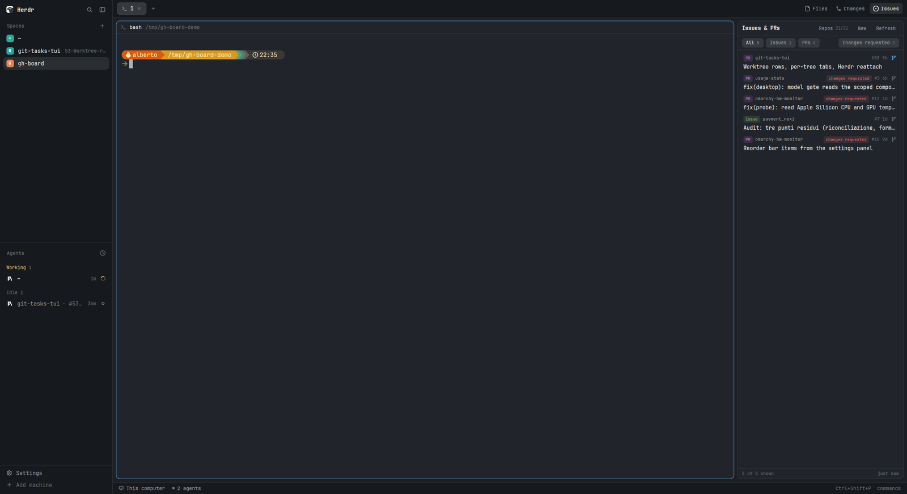

# Issues & PRs

A panel for Herdr that lists the open issues and pull requests of every GitHub repo checked out in one folder, shows one's full details on hover or pinned at the bottom of the column, and turns one into a git worktree with a coding agent already running in it.



## What you see

The package is a layout (`main-gh`) and three mods, so what you see is Herdr's own window with three changes.

**The tab bar** gains a third panel button, `Issues` (a circle-with-dot icon, `mods/gh-board/inbox.svg`), after `Files` and `Changes`, 26 px tall, using the same active/inactive look as the other two.

**The right column** is Herdr's `panel` node, hidden until a button opens it: 368 px by default (min 280, max 900). Inside it the `panel-body` stack gained a third child, `gh-board`, next to `files` and `changes`. The panel draws its own card on the theme: `rounded(10)`, 1 px `border`, `background` fill, 12.5 px text.

Top to bottom:

1. **Header, 36 px**: `Issues & PRs` in semibold, a `Repos 21/21` button (picked of scanned), a `New` button, and `Refresh`, which turns into a native spinner (`frames(["◐","◓","◑","◒"], 200)`) while a refresh runs. All three are text buttons, 20 px tall, `muted` until hovered.
2. **Filter bar**: three chips — `All N`, `Issues N`, `PRs N` — 22 px tall, `raised` fill, `selected` fill for the active one; and, right-aligned, `Changes requested N ✕` in `ansi1` (red) on a 13% red tint when on. All four sit on one line when they fit; `flex_1` spacer before the red chip pushes it right, and when the estimated widths do not fit the red chip moves to a second line, still right-aligned. Nothing overlaps: the label truncates, the count and the ✕ do not.
3. **The list**, scrollable, 6 px padding, 1 px gaps. One row per item, two lines in a narrow panel: line one is the kind pill (`PR`, 22 px wide, `ansi5` purple; or `Issue`, 40 px, `ansi2` green, these colours at 13% for the fill), the repo name (`muted`, truncated), the tags, `#number`, the age, and the branch button; line two is the title in `foreground`, truncated. Tags are 16 px pills: `draft` (`dim`), `approved` (`ansi2`), `changes requested` (`ansi1`), then the item's own labels. A wide panel (620 px+) puts everything on one 30 px row and adds the author. A selected row keeps a `selected` fill.
4. **The docked card**, 300 px tall, `background` fill with a top border, only while a row is selected: header (`PR`/`Issue` pill, `#number`, repo, state, `✕`), the title at 13 px semibold, a `dim` meta line (`by author · opened 2026-11-01 · updated 5h`), the tags, a stats line in the item's tone (`+3334 −300 · 24 files · fixes → main · changes requested`), the description as markdown (`TextView.markdown`, 11.5 px, `muted`, filling and scrolling in the leftover space), and a footer with `Open worktree` (solid when that worktree exists), `New worktree` (solid when it does not) and `GitHub ↗`.
5. **Status line, 24 px**: `5 of 5 shown` (or the error, in `ansi1`), `N failed` in `ansi3` when some repos could not be asked, and `updated 4m ago`.

**Two dialogs** open from the panel, both `frame: "none"` so they draw their own card on `popover` with `rounded(12)` and `shadow_lg`:

- `Worktree + agent`, 560 px: header, the item (or `from scratch`), `Repo` (dropdown, from-scratch mode only), `Worktree` + the full destination path in `dim`, `Branch` (+ a `▾ N` popover listing the repo's existing branches, from-scratch mode), the agent dropdown, and `Cancel` / `Create`. Fields are 30 px, `chrome` fill, `input` border.
- `Repos`, 480 px: `Repos` + `N of M`, the scanned folder path, `Rescan` and `Folder…`, a list of `owner/name` rows with 14 px checkboxes (`accent` when on), and `All` / `None` / `Done`.

## How it behaves

**Data.** On start the mod reads `~/repo` (or `shared("gh-board.root")`), runs `git config --get remote.origin.url` in every subfolder, keeps the unique `github.com` remotes, publishes `[{repo, dir}]` as `shared("gh-board.repos")`, prunes `shared("gh-board.selected")` to the repos that still exist, and then asks `gh api graphql` once per 20 repos for `issues(states: OPEN, first: 50)` and `pullRequests`, sorted by `UPDATED_AT`. Items are sorted newest-updated first. It refreshes every 60 s, on `Refresh` (which also rescans the folder), and whenever another mod changes the picked repos, the folder, or asks for a rescan.

**States.** Working, blocked, done and idle appear as ordinary rows (an agent's own reporting is not involved). A PR with `reviewDecision: CHANGES_REQUESTED` gets the red `changes requested` tag everywhere, and can be filtered out.

**Filters.** `All` / `Issues` / `PRs` are exclusive, act on `on_mouse_down` (not the click cycle) and persist in `localStorage`. `Changes requested` narrows the same list on top of the active tab and persists too; its count is the number hidden while it is on. Changing either gives the list a new element id, so it starts at the top instead of keeping the old scroll offset.

**Hover.** Resting on a row for a moment fetches that item's details (`gh pr view` / `gh issue view --json`) once, cached until its `updatedAt` changes, and shows a 440 px card in a `Popup` layer anchored `right_center` of the row: same content as the docked card, but with the description in a fixed box (up to 320 px, estimated from the wrapped line count) instead of filling the column. Leaving the row and not entering the card closes it after 220 ms. Only the row under the pointer builds a card.

**Click.** A row selects it (docked card, second click closes). The branch button opens the item's existing worktree if there is one — `space.select` on the space whose folder is the worktree, plus `tab.select` when a tab with that name exists — otherwise it opens the `Worktree + agent` dialog. Selecting the `New` button opens the same dialog in `from scratch` mode.

**The dialogs.** In `Worktree + agent` the worktree and branch default to `slug("<number>-<title>")` of the item (or the repo folder's name from scratch); the agent defaults to the one remembered in `shared("gh-board.agent")`, else the first installed. `Create` does `git worktree add` into `~/.herdr/worktrees/<repo>/<name>` (with `-b <branch> HEAD` when the branch does not exist), then `space.new {name: <repo>, folder: <worktree>, tab: "<#number> title", argv: <agent>}`. If that folder is already a space it selects it and adds the tab instead. Escape, the dialog frame's ✕-free cancel path or `Cancel` closes it; Enter in either field creates.

**In the repo picker**, clicking a row toggles it immediately (shared state, so the panel refetches behind the dialog), `All` sets the selection to `null` (meaning every repo), `None` to an empty list, `Folder…` calls Herdr's system folder picker and `Rescan` bumps `shared("gh-board.rescan")`.

**Keys.** None of its own: it uses Herdr's.

## Built from

The layout is Herdr 0.1.11's `main`, copied by `layout.clone`, with two edits: the `tabs` block's `content.mod` is `tabs-gh`, and `panel-body` (the stack in the `panel` column, min 280 / max 900, hidden) gained

```json
{ "id": "gh-board", "type": "block", "content": { "mod": "gh-board" } }
```

`mods/tabs-gh` is Herdr 0.1.11's `tabs` copied by `mod.clone`, with `gh-board` unioned into the `enabled` list (so a `workspace.panels` value that predates it does not hide the button) and one more `panelButton("gh-board", "Issues", "mods/gh-board/inbox.svg")`.

`mods/gh-board/main.js` (≈570 lines) is the panel: `View` with `init(props, cx)`, a 60 s `cx.timer.every`, and `cx.spawn` for every host call. It uses `div/h_flex/v_flex`, `Popup`, `TextView.markdown`, and from `herdr`: `exec`, `home()`, `theme()`, `settings()`, `openOverlay`, `run`, `spaces`, `shared`, `setShared`, plus `fs/promises`' `readdir`. Commands it runs: `space.select`, `tab.select`, `pane`-free; programs: `git`, `gh`, `xdg-open`/`open`. Images: `mods/gh-board/branch.svg` (octicon git-branch, 16 px grid) and `mods/gh-board/inbox.svg` (octicon issue-opened).

`mods/gh-new/main.js` is the dialog: `InputState` + `Input` for the two names, three `Popover`s (repo, branch, agent), `pickFolder()` for "other folder", `knownAgents()` for the list, and `exec("git", …)` + `run("space.new")` to make the checkout. Its own `check.svg`.

`mods/gh-repos/main.js` is the picker: `pickFolder()`, `shared`/`setShared`, `svg` for the checkmark.

Shared state between them: `gh-board.repos` (`[{repo, dir}]`), `gh-board.selected` (`null` or `[owner/name]`), `gh-board.root` (folder), `gh-board.rescan` (a timestamp), `gh-board.agent` (an agent name, `null`, or `"shell"`).

## Watch out

- **Two clones, one copy each.** `main-gh` and `tabs-gh` are snapshots: they do not track Herdr. Re-clone and re-apply the two edits above when you want the shipped versions' improvements.
- **The panel is where the clones meet.** Without `tabs-gh` there is no `Issues` button; without the `gh-board` block in `panel-body` the button toggles nothing. Both edits are one line each.
- **Names must match across mods.** `gh-board` finds a worktree by path: `~/.herdr/worktrees/<repo folder name>/<slug(number-title)>`, and the tab by its name (`"#12 title"`, truncated to 64). `gh-new` builds the same two strings. Change the naming formula in one and "Open worktree" stops finding the other's worktrees.
- **Widths are estimated.** The one-line/two-line decision for the filter chips uses a character-width estimate (`0.56 × font size` in the monospace UI font, times `settings().zoom`, plus padding and 12 px slack), calibrated against a 396 px panel at zoom 1.1. A very different zoom or font may wrap a little early or late — never overlap.
- **One `spaces()` per render.** Every call into the app is a host round trip; calling it per row made every re-render (and so every filter click) slow. The render builds one `Set` of space folders and `ready(item)` consults it.
- **Only one hover card is built.** Building a card (with a markdown parse) for every visible row made clicks sluggish; the card is built only for the hovered row via `Popup` + `hoverKey`, with a 220 ms close delay and a `hoverHold` flag so moving into the card keeps it.
- **Ids must be unique per render.** The docked card and the hover card render the same buttons; they use `gh-dock-…` and `gh-card-…` prefixes. Duplicated ids cost hit-testing.
- **A broken render leaves a strip.** While developing this I saved a build that threw during render and Herdr showed "This view could not be re-rendered…" inside the block until the block was recreated; `herdr-app status` reported no error. `layout.hide`/`layout.show` on the block clears it.
- **Repo names come from `git`.** A folder whose `origin` is not `github.com` is skipped entirely — no error, it just is not in the list.
- **Only the first 50 open items per repo** and the first 300 shown; the footer says so. GraphQL `issues` does not include PRs, so nothing is counted twice.
- **`gh` must be authenticated on this machine** — the panel shows `gh`'s own error text (in the status line) when it is not.
- The `Oh My Pi` entry that the screenshots show was added by hand in `programs.json` (`run: ["omp"]`); it is not part of this package.

## Done when

1. `herdr-app check` passes for `gh-board`, `gh-new`, `gh-repos` and `tabs-gh`.
2. `herdr-app do layout.switch --name main-gh` shows a third `Issues` button in the tab bar, and clicking it opens a right-hand column with the header `Issues & PRs`, a `Repos N/N` count, and as many rows as the folder's repos have open items (or `Nothing open`, which is a valid result).
3. Clicking `All` / `Issues` / `PRs` changes the rows within a frame, and the counts in the chips match the rows.
4. With at least one PR in `changes requested`, the chip appears red at the right; clicking it removes those rows and adds a `✕`, and the ✕ puts them back.
5. Clicking `Repos` lists every repo the panel scanned, `All` / `None` change the count in the panel behind it, and `Rescan` picks up a checkout created after the panel started.
6. Hovering a row shows a card to its left with a real description; clicking the row docks the same card at the bottom of the column with `Open worktree` / `New worktree` / `GitHub`.
7. `New worktree` on a PR opens the dialog with the worktree and branch named after it; `Create` produces a space named after the repo, containing a checkout under `~/.herdr/worktrees/` (verify with `git worktree list` in the repo) and a tab named `#<number> <title>` running the chosen agent with an empty prompt.
8. On that same PR, the branch button now switches to that space instead of opening the dialog, and the icon is accent-coloured.
